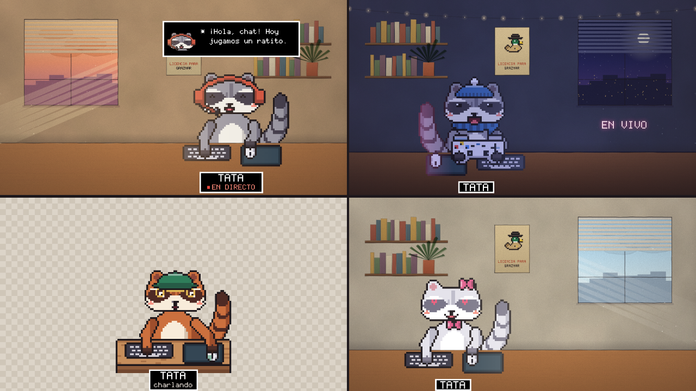
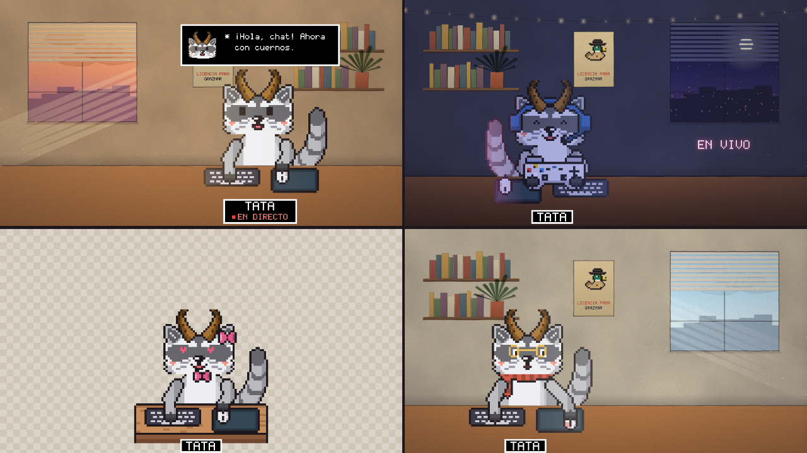

# Tata · mapache VTuber

Un VTuber de mapache en el estilo de las películas de **Almagre Studios**: sprite de 8 bits con contorno oscuro y mejillas sonrosadas, sobre un cuarto pintado en acuarela.

<p align="center"></p>

- **Habla cuando hablas.** Escucha el micrófono y abre la boca en dos tamaños según el volumen, con un saltito opcional.
- **Enseña lo que usas.** Mueve el ratón sobre su alfombrilla, se le encienden los botones al hacer clic, teclea cuando tecleas y saca el mando cuando juegas con mando (cruceta, botones, gatillos y sticks).
- **Mira hacia el cursor**, parpadea solo, respira y mueve la cola.
- **8 expresiones** (normal, feliz, sorpresa, triste, enfadado, enamorado, guiño y dormido) con atajos de teclado.
- **Bocadillo de diálogo** como en las películas, con el retrato del mapache y bleeps opcionales.
- **Panel de configuración**: micrófono, pelaje, accesorios, colores, fondo, tamaño, cartel con el nombre…
- **Dos personajes**: el mapache clásico y el **mapache con cuernos** de carnero, pasado a pixel desde el dibujo de Tata.

<p align="center"></p>

Es **un solo archivo HTML** (`mapache.html`), sin librerías ni internet. El `ayudante.py` es opcional.

## Probarlo ya

1. Descarga la carpeta y abre `mapache.html` con **Chrome** o **Edge** (doble clic).
2. Acepta el permiso del micrófono y habla.
3. Pulsa **H** para abrir o cerrar el panel. El engranaje aparece arriba a la derecha al mover el ratón.

Para verlo moverse sin micrófono, abre el panel → *Guardar y atajos* → **Modo demostración**, o añade `?demo=1` a la dirección.

## Usarlo en OBS

### Opción A (recomendada): fuente de navegador + ayudante

El navegador solo ve el ratón cuando está encima de su ventana, y dentro de OBS no lo ve nunca. El **ayudante** lee el ratón, el teclado y el mando de todo el escritorio y se lo pasa al mapache.

1. Instala [Python 3](https://www.python.org/downloads/). En Windows, marca «Add Python to PATH» en el instalador.
2. En la carpeta del mapache, ejecuta:
   ```bash
   python ayudante.py
   ```
   (En Windows también vale doble clic sobre `ayudante.py`.) Déjalo abierto mientras haces directo.
3. Si OBS está abierto, ciérralo. Ábrelo con permiso para usar el micrófono desde las fuentes de navegador:
   - **Windows:** clic derecho en el acceso directo de OBS → *Propiedades* → en *Destino*, añade al final, después de las comillas: ` --enable-media-stream --use-fake-ui-for-media-stream`
   - **macOS:**
     ```bash
     open -a OBS --args --enable-media-stream --use-fake-ui-for-media-stream
     ```
4. En OBS: **Fuentes → + → Navegador**.
   - **URL:** `http://127.0.0.1:8765/`
   - **Ancho / Alto:** el de tu lienzo (por ejemplo 1920 × 1080).
5. Para configurarlo: clic derecho en la fuente → **Interactuar** → pulsa **H**. Los ajustes se guardan dentro de OBS.

Con el fondo **Transparente**, el mapache queda directamente sobre el juego. Para encuadrarlo, recorta o escala la fuente como cualquier otra.

> Si el micro no reacciona en OBS, comprueba el paso 3: OBS tiene que abrirse con esas opciones. Si aun así no funciona, usa la opción B.

### Opción B: ventana del navegador + croma

1. Abre `mapache.html` (o `http://127.0.0.1:8765/` si usas el ayudante) en Chrome o Edge.
2. En el panel, pon el fondo en **Croma** y cierra el panel con **H**.
3. En OBS: **Captura de ventana** del navegador y añade el filtro **Clave de croma** con el mismo color.

Chrome deja de dibujar las ventanas tapadas por completo. Si el mapache se congela cuando el juego lo cubre, déjalo en otro monitor o abre Chrome con `--disable-features=CalculateNativeWinOcclusion`.

### Sin OBS

El fondo **Cuarto de Almagre** sirve tal cual para charlas o vídeos: graba la ventana del navegador con cualquier programa de captura.

## Atajos

| Tecla | Qué hace |
|---|---|
| `H` | Mostrar u ocultar el panel |
| `1` … `8` | Normal, feliz, sorpresa, triste, enfadado, enamorado, guiño, dormido |
| `0` | Volver a normal |
| `9` | Siguiente frase del bocadillo |
| `M` | Silenciar la boca |
| `Ctrl` + `Alt` + número | Lo mismo, desde cualquier programa (necesita el ayudante) |

Las teclas sueltas solo funcionan con la ventana del mapache activa. Durante un directo, usa `Ctrl` + `Alt` + número con el ayudante en marcha.

## Los personajes

En el panel → *Mapache* → **Personaje**:

- **Mapache clásico**: con su antifaz de bandido, la raya en la frente y la boca en ω.
- **Mapache con cuernos**: orejas grandes de borde claro, cuernos curvos y puntiagudos con estrías, ojos altos y negros, nariz con brillo, boca ondulada, bigotes y babero blanco. Al elegirlo se pone el pelaje **Plata** y se quitan los gorros y los auriculares para que se vean los cuernos. Después se pueden volver a poner.

Las expresiones, los accesorios, el ratón, el teclado y el mando funcionan igual con los dos. También se puede elegir en la dirección: `?personaje=cuernos`.

## Ajustar el micrófono

En el panel, la barra muestra el volumen en tiempo real:

- la **raya roja** es el punto a partir del cual el mapache abre la boca;
- la **raya negra** es el punto en que la abre del todo.

Si mueve la boca con el ruido del ventilador, sube la raya roja o pulsa **Calibrar** y quédate 2 segundos en silencio. Si le cuesta abrirla, bájala.

## El mando

- **En el navegador** (Chrome, Edge, Firefox) se detecta solo al pulsar cualquier botón: Xbox, PlayStation, Switch Pro y la mayoría de mandos USB.
- **Dentro de OBS**, el ayudante lo lee en Windows (mandos XInput: Xbox y compatibles; los de PlayStation, con Steam o DS4Windows) y en Linux (`/dev/input/js0`).

Con **«Enseñar: Lo último que uses»**, el mapache saca el mando en cuanto lo tocas y vuelve al ratón cuando lo mueves.

## El ayudante y la privacidad

`ayudante.py` solo usa la biblioteca estándar de Python y escucha únicamente en `127.0.0.1`, así que nada sale de tu ordenador.

- **Ratón:** solo manda a la página la posición relativa en la pantalla y los botones pulsados.
- **Teclado:** solo cuenta **cuántas** teclas pulsas, para que el mapache teclee; nunca cuáles. La única excepción son los atajos `Ctrl` + `Alt` + número.
- `python ayudante.py --sin-teclado` desactiva el teclado del todo.
- `python ayudante.py --demo` se inventa los movimientos, para comprobar que la conexión funciona.
- `python ayudante.py --puerto 9000` usa otro puerto; cámbialo también en el panel.

| Sistema | Ratón y teclado | Mando |
|---|---|---|
| Windows | Sí | XInput |
| macOS | Sí. Puede pedir permiso de *Monitorización de entrada* para el Terminal o Python. | Lo lee el navegador |
| Linux X11 | Sí | `/dev/input/js0` |
| Linux Wayland | No (Wayland no deja leer el ratón global) | `/dev/input/js0` |

## Llevar los ajustes de un sitio a otro

Los ajustes se guardan en el navegador donde los hiciste. Chrome y OBS no comparten los suyos: usa **Exportar** en uno e **Importar** en el otro (panel → *Guardar y atajos*).

También se pueden poner en la dirección, por ejemplo:

```text
http://127.0.0.1:8765/?fondo=transparente&pelaje=rojizo&cabeza=gorro&nombre=Tata
```

## Personalizarlo más (código)

Todo está en `mapache.html`:

- `CAB_IZQ` y `CUE_IZQ`: media cabeza de cada personaje, dibujada a mano carácter a carácter; se refleja para hacer la otra mitad.
- `PERSONAJES`: dónde van los ojos, la nariz y el rubor de cada uno, y qué lleva (cuernos, bigotes, babero…).
- `cuernos()`: los cuernos (una media luna que se afila hacia la punta).
- `PELAJES`: las paletas de pelaje.
- `ojos()` y `boca()`: las expresiones.
- `armarCabeza()`: los accesorios.
- `pintarEscena()`: cuerpo, cola, escritorio, teclado, ratón y brazos.
- `pintarMando()`: el mando.
- `pintarFondo()`: el cuarto de Almagre.

Cada letra de la cuadrícula es un color de la paleta (`K` contorno, `G` pelo, `M` antifaz, `W` blanco, `A` color de los accesorios…).

## Créditos

El estilo, la fuente pixel de las cajas de diálogo y el cartel de Ramiro Lagos vienen de [Claude-Hollywood](https://github.com/Anoth3rHellsing/Claude-Hollywood) (Almagre Studios, CC BY-NC-SA 4.0).
